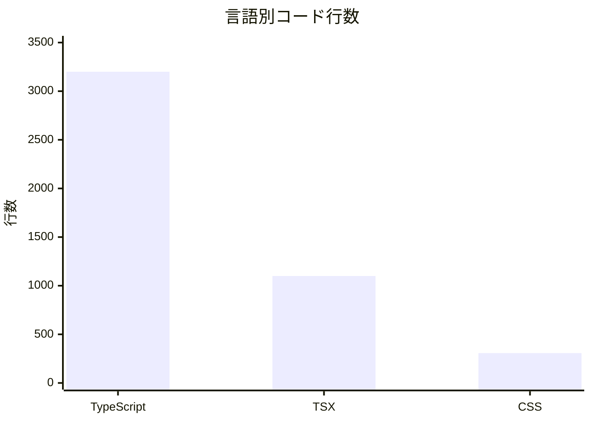
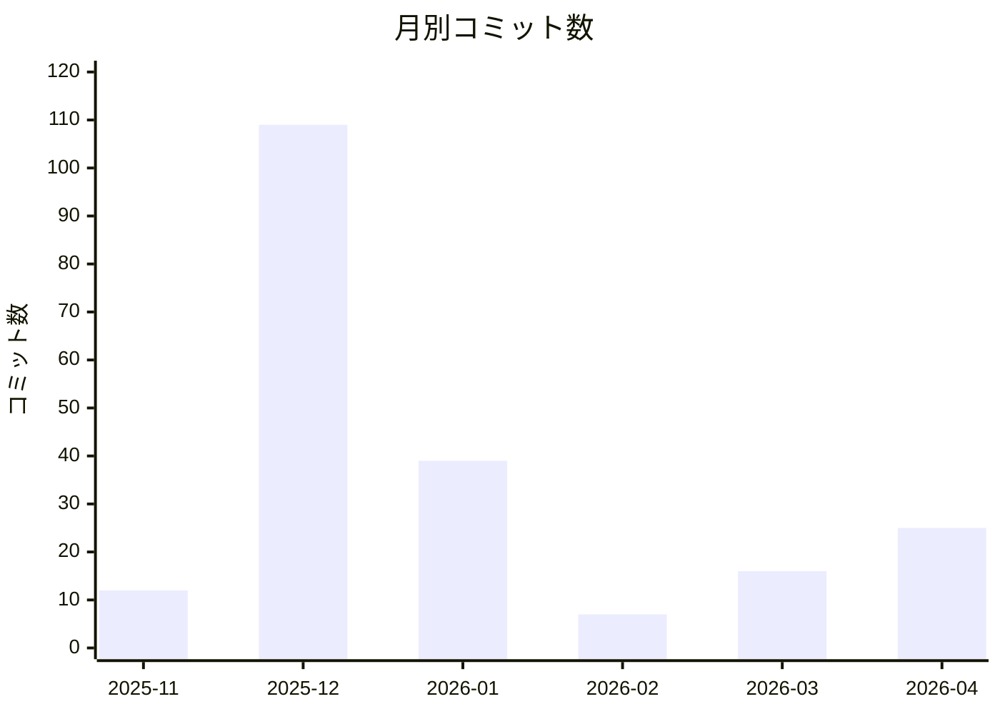

# 数字で見る

> 最終更新: 2026-05-13

## 全体統計

| 指標                      | 値         |
| ------------------------- | ---------- |
| ソースコード行数          | ~4,607 LOC |
| ソースファイル数 (ts/tsx) | 51         |
| テストコード行数          | ~2,095 LOC |
| テストファイル数          | 20         |
| テスト/ソース比           | 0.45       |
| ランタイム依存            | 15         |
| 開発依存                  | 22         |
| TODO数                    | 0          |

## レイヤー別ファイル数

| レイヤー       | ファイル数 |
| -------------- | ---------- |
| メインプロセス | 16         |
| レンダラー     | 29         |
| 共有           | 6          |

## 言語構成

## 月別コミット数

## 変更頻度（チャーン）上位

| ファイル                                 | 変更回数 |
| ---------------------------------------- | -------- |
| `src/main/adapters/AppAdapter.ts`        | 4        |
| `src/renderer/components/ToolCard.tsx`   | 3        |
| `src/renderer/components/PresetCard.tsx` | 3        |
| `src/main/services/LauncherService.ts`   | 2        |

## その他

| 指標             | 値                                         |
| ---------------- | ------------------------------------------ |
| ボットコミット率 | ~3% (6コミット)                            |
| 最大ファイル     | `src/main/adapters/AppAdapter.ts` (~200行) |
| 最小ファイル     | `src/main/adapters/OSAdapter.ts` (~10行)   |
