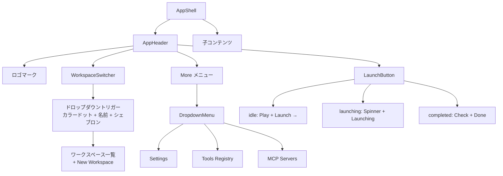

# アプリヘッダーとスイッチャー

**アクティブコントリビューター:** akkytech, Akihide Ito

## 概要

アプリヘッダーは AgiRity の上部固定バー（44px）で、ワークスペース切替、起動ボタン、設定メニューを集約しています。主要なナビゲーションとアクションのハブとして機能します。

## AppHeader（44px 固定）

`src/renderer/components/layout/AppHeader.tsx` は高さ `h-11`（44px）の固定ヘッダーバーです。

### 構成要素（左 → 右）

| 要素 | 内容 |
|------|------|
| **ロゴ** | 22×22px の角丸四角に "A" 文字（プライマリカラー） |
| **セパレータ** | 垂直線（HeroUI `Separator`） |
| **WorkspaceSwitcher** | ワークスペース選択ドロップダウン |
| **スペーサー** | `flex-1` で右側にプッシュ |
| **LaunchButton** | 起動状態付きボタン |
| **More メニュー** | 設定・ツール・MCP サーバーへのアクセス |

## WorkspaceSwitcher

`src/renderer/components/workspace/WorkspaceSwitcher.tsx` はドロップダウン形式のワークスペース切替 UI です。

### トリガー表示

- **カラードット:** 青色（`#4a90e2`）の 10px 円形
- **ワークスペース名:** 最大幅 40（`max-w-40`）でトランケート
- **シェブロン:** `ChevronDown` アイコン（グレー）
- 未選択時は "Select workspace" を表示

### ドロップダウン項目

| 項目 | 表示 | 動作 |
|------|------|------|
| 各ワークスペース | カラードット + 名前 + "{count} items" バッジ | `onSelect(id)` 呼出 |
| 新規作成 | `Plus` アイコン + "New Workspace"（プライマリカラー） | `onNew()` 呼出 |

## LaunchButton

`src/renderer/components/workspace/LaunchButton.tsx` は 3 つの状態を持つ起動ボタンです。

| 状態 | アイコン | テキスト | ボタン variant |
|------|---------|----------|---------------|
| `idle` | `Play` | "Launch →" | `primary` |
| `launching` | `Spinner` | "Launching" | `primary`（disabled） |
| `completed` | `Check`（緑） | "Done" | `outline`（disabled） |

- `isLaunching` が `true` で `launching` に遷移
- `isLaunching` が `false` に戻ると `completed` に遷移
- **2 秒後** に自動的に `idle` にリセット（再度起動した場合はタイマーを張り直す）
- クリック時は `MainPanel` で選択中のプリセットのアイテムのみを起動（未選択時は全件）

## More メニュー

HeroUI `Dropdown` を使用した 3 項目のメニュー。

| 項目 | アイコン | アクション |
|------|---------|-----------|
| Settings | `Settings` | `onOpenSettings()` |
| Tools Registry | `Box` | `onOpenTools()` |
| MCP Servers | `Database` | `onOpenMCP()` |

## コンポーネント構造

## 主要ファイル

| ファイル | 役割 |
|---------|------|
| `src/renderer/components/layout/AppHeader.tsx` | ヘッダーバーのメインコンポーネント |
| `src/renderer/components/layout/AppShell.tsx` | ヘッダー + コンテンツのレイアウト |
| `src/renderer/components/workspace/WorkspaceSwitcher.tsx` | ワークスペース切替ドロップダウン |
| `src/renderer/components/workspace/LaunchButton.tsx` | 3 状態起動ボタン |
| `src/renderer/App.tsx` | 状態管理とイベントハンドラーの統合 |
| `src/renderer/components/layout/MainPanel.tsx` | メインコンテンツエリア（プリセット選択、ワークスペース編集ボタン） |
| `src/renderer/components/layout/EmptyWorkspacePanel.tsx` | ワークスペース未作成時のパネル |
