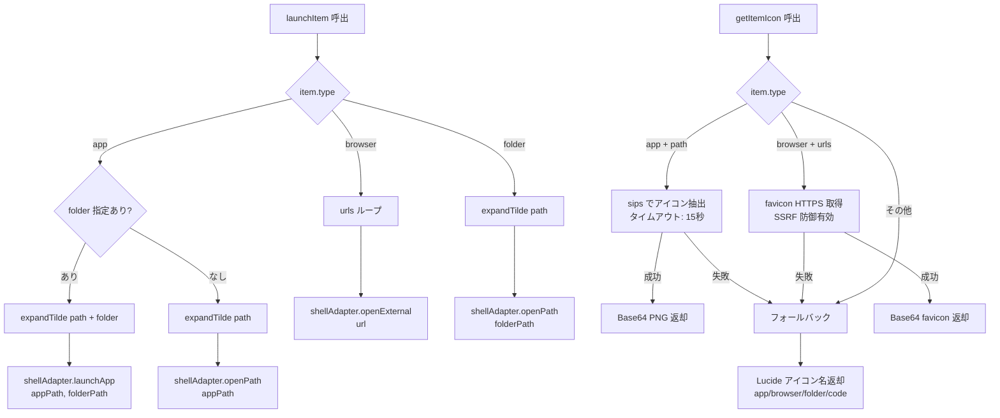

# アプリランチャー

**アクティブコントリビューター:** akkytech, Akihide Ito

## 概要

アプリランチャーは、ワークスペースアイテムのタイプ（`app` / `browser` / `folder`）に応じて適切な起動方法をディスパッチする機能です。`LauncherService` が中央のディスパッチャとして機能し、パス展開、アイコン取得、SSRF 防御などのセキュリティ対策も内包しています。

## LauncherService ディスパッチ

`src/main/services/LauncherService.ts` の `launchItem()` はアイテムタイプに基づいて起動メソッドを振り分けます。

| タイプ | メソッド | 動作 | 使用 API |
|--------|---------|------|----------|
| `app` | `launchApp()` | `folder` 指定時: `launchApp(appPath, [folderPath])` 未指定時: `openPath(appPath)` | `ShellAdapter` |
| `browser` | `launchBrowser()` | URL ごとに `openExternal(url)` を呼び出し | `ShellAdapter` |
| `folder` | `launchFolder()` | `openPath(folderPath)` で Finder 等で開く | `ShellAdapter` |

### パス展開

全タイプで `ConfigService.expandTilde()` を使用し、`~/` を実際のホームディレクトリに展開してから起動します。

```typescript
const appPath = this.configService.expandTilde(item.path);
const folderPath = this.configService.expandTilde(folder);
```

## アイコン取得

`getItemIcon()` はアイテムタイプとパスに基づいてアイコンを取得します。取得に失敗した場合は Lucide フォールバックアイコン名を返します。

### macOS アプリアイコン（sips）

`AppAdapter.getAppIconViaSips()` は macOS ネイティブツールを使用して `.app` からアイコンを抽出します。

1. **PlistBuddy** で `Info.plist` の `CFBundleIconFile` を読み取り
2. `.icns` ファイルパスを構築（`Contents/Resources/` 配下）
3. **sips** で `.icns` → PNG に変換（一時ファイル経由）
4. PNG バッファを Base64 エンコードして返却
5. 一時ファイルをクリーンアップ

**タイムアウト:** 15秒（`APP_ICON_TIMEOUT_MS`）

### favicon 取得（HTTPS）

`AppAdapter.fetchFavicon()` はブラウザアイテムのファビコンを取得します。

1. **第一候補:** `https://{hostname}/favicon.ico` から直接取得
2. **フォールバック:** `AGIRITY_ALLOW_EXTERNAL_FAVICONS=true` の場合のみ Google favicon API を使用

**SSRF 防御:**

| 防御 | 内容 |
|------|------|
| HTTPS 強制 | `http:` スキームをブロック |
| プライベート IP ブロック | IPv4（127.x, 10.x, 172.16-31.x, 192.168.x, 169.254.x, 0.0.0.0） |
| IPv6 ブロック | `::1`, `fc`/`fd` (ULA), `fe80-` (リンクローカル), `::ffff:` マップ |
| ホスト名ブロック | `localhost`, `0.0.0.0` |
| DNS 解決検証 | 全 DNS 解決結果の IP アドレスを検証 |
| サイズ制限 | 512KB（`MAX_FAVICON_BYTES`） |
| リダイレクト制限 | 最大 2 回（`MAX_FAVICON_REDIRECTS`） |
| タイムアウト | 5秒（`FAVICON_FETCH_TIMEOUT`） |

### フォールバックアイコン

アイコン取得に失敗した場合、タイプに応じた Lucide アイコン名を返却。

| タイプ | フォールバックアイコン |
|--------|---------------------|
| `app` | `app` |
| `browser` | `browser` |
| `folder` | `folder` |
| その他 | `code` |

## ディスパッチフロー



## 主要ファイル

| ファイル | 役割 |
|---------|------|
| `src/main/services/LauncherService.ts` | 起動ディスパッチとアイコン取得の調整 |
| `src/main/adapters/AppAdapter.ts` | sips アイコン抽出、favicon 取得、SSRF 防御 |
| `src/main/adapters/ShellAdapter.ts` | `openPath`, `openExternal`, `launchApp` の実行 |
| `src/main/services/ConfigService.ts` | `expandTilde()` パス展開 |
| `src/main/container.ts` | DI コンテナ（`LauncherService` への依存注入） |
| `src/shared/types.ts` | `LaunchResult`, `IconResult`, `WorkspaceItem` 型 |
| `src/renderer/api/index.ts` | レンダラー側 IPC API |
