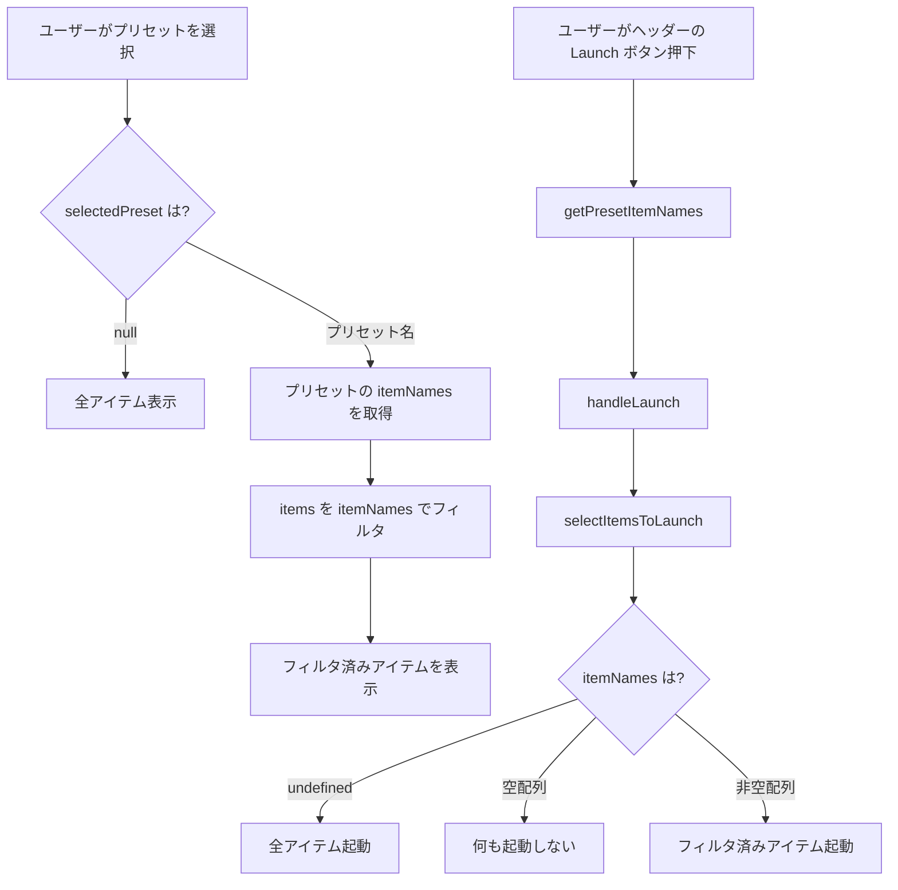

# プリセット起動

**アクティブコントリビューター:** akkytech, Akihide Ito

## 概要

プリセット起動機能は、ワークスペース内のアイテムをグループ化して選択的に起動する仕組みです。ユーザーが定義したプリセット（アイテム名のリスト）に基づいて、起動対象をフィルタリングします。

## selectItemsToLaunch() — フィルタリングロジック

`src/shared/lib/workspace-utils.ts` の `selectItemsToLaunch()` は、プリセットのアイテム名リストに基づいて 3 つのケースを処理します。

| `itemNames` の値 | 動作 | ユースケース |
|-----------------|------|-------------|
| `undefined` | ワークスペースの **全アイテム** を返却 | プリセット未選択時の全件起動 |
| `[]`（空配列） | **空配列** を返却 | 何も起動しない |
| `["VS Code", ...]`（非空） | `itemNames` に含まれる名前で **フィルタリング** | プリセット選択時の部分起動 |

```typescript
// src/shared/lib/workspace-utils.ts
export const selectItemsToLaunch = (
  workspace: Workspace,
  itemNames?: string[]
): WorkspaceItem[] => {
  if (itemNames === undefined) return workspace.items;
  if (itemNames.length === 0) return [];
  return workspace.items.filter((item) => itemNames.includes(item.name));
};
```

## getPresetItemNames() — 選択中プリセットの解決

ヘッダーの起動ボタンは `App.tsx` で `getPresetItemNames(workspace, selectedPreset)` を呼び、結果を `handleLaunch` に渡します。

| `selectedPreset` | 戻り値 | 起動対象 |
|------------------|--------|---------|
| `null` | `undefined` | 全アイテム |
| 定義済みプリセット名 | そのプリセットの `itemNames`（空配列も保持） | プリセットのアイテム（空なら0件） |
| 未定義のプリセット名（デフォルト "Launch All" を含む） | `undefined` | 全アイテム |

## PresetChips UI

`src/renderer/components/workspace/PresetChips.tsx` は HeroUI の `Chip` コンポーネントを使用してプリセット選択 UI を提供します。

- 選択状態: `variant="primary"`（ハイライト）
- 未選択状態: `variant="tertiary"` + ボーダー
- クリックで `onSelect(preset.name)` を呼び出し
- ホバー時に `hover:border-primary hover:text-primary` でフィードバック

## デフォルト "Launch All" プリセット

ワークスペースにプリセットが定義されていない場合、`MainPanel` が自動的にデフォルトプリセットを生成します。

```typescript
// src/renderer/components/layout/MainPanel.tsx
const presets = workspace.presets ?? [
  {
    name: 'Launch All',
    description: 'Start all items in this workspace',
    itemNames: workspace.items.map((i) => i.name),
  },
];
```

## MainPanel フィルタリングロジック

`MainPanel` は `selectedPreset` の値に基づいて表示アイテムをフィルタリングします。

- `selectedPreset` が `null` → 全アイテム表示
- `selectedPreset` が選択済み → プリセットの `itemNames` に一致するアイテムのみ表示

```typescript
const filteredItems = selectedPreset
  ? workspace.items.filter((item) => {
      const preset = presets.find((p) => p.name === selectedPreset);
      return preset ? preset.itemNames.includes(item.name) : true;
    })
  : workspace.items;
```

## フロー図



## 主要ファイル

| ファイル | 役割 |
|---------|------|
| `src/shared/lib/workspace-utils.ts` | `getPresetItemNames()` プリセット解決と `selectItemsToLaunch()` フィルタリングロジック |
| `src/renderer/components/workspace/PresetChips.tsx` | プリセット選択チップ UI |
| `src/renderer/components/layout/MainPanel.tsx` | プリセットによるアイテムフィルタリングと表示 |
| `src/renderer/components/workspace/LaunchButton.tsx` | 起動ボタン（idle/launching/done 状態管理） |
| `src/renderer/components/workspace/LaunchItemCard.tsx` | 個別アイテムカード（ネイティブ `button`、一括起動中は無効化） |
| `src/shared/types.ts` | `WorkspacePresetSchema`, `WorkspacePreset` 型定義 |
| `src/renderer/App.tsx` | 起動ハンドラー `handleLaunch` の定義 |
