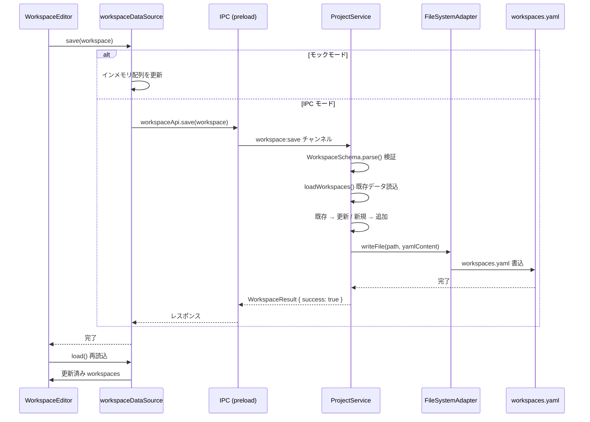

# ワークスペース管理

**アクティブコントリビューター:** akkytech, Akihide Ito

## 概要

ワークスペース管理は AgiRity の中核機能であり、プロジェクト作業に必要な複数アプリをグループ化して管理・起動します。YAML ファイルによる永続化、Zod スキーマによる検証、リアクティブな UI コンポーネントを組み合わせて CRUD ライフサイクルを実現しています。

## CRUD ライフサイクル

| 操作       | フロー                                                                                         | 成果物                 |
| ---------- | ---------------------------------------------------------------------------------------------- | ---------------------- |
| **Create** | UI → `WorkspaceEditor` → `workspaceDataSource.save()` → IPC → `ProjectService.saveWorkspace()` | 新規 YAML エントリ     |
| **Read**   | アプリ起動 → `workspaceDataSource.load()` → IPC → `ProjectService.loadWorkspaces()`            | `Workspace[]`          |
| **Update** | UI → `WorkspaceEditor` → `workspaceDataSource.save()` → IPC → `ProjectService.saveWorkspace()` | 更新済み YAML エントリ |
| **Delete** | UI → IPC → `ProjectService.deleteWorkspace()`                                                  | YAML エントリ削除      |

## 主要コンポーネント

### ProjectService（`src/main/services/ProjectService.ts`）

YAML ファイルの永続化と Zod スキーマによるバリデーションを担当するメインプロセスサービス。

- **読み込み:** `workspaces.yaml` を読み込み、YAML パース → Zod 検証 → `Workspace[]` を返却
- **保存:** `WorkspaceSchema` で入力検証 → 既存配列を更新 → YAML 書き戻し
- **削除:** ID でフィルタリング → 配列再構築 → YAML 書き戻し
- **ファイル不在:** `ENOENT` の場合は空配列を返却（初回起動時）

### ConfigService（`src/main/services/ConfigService.ts`）

`~/.agirity/` ディレクトリ管理と設定パスの解決。

- `getConfigDir()` — `~/.agirity/` または `AGIRITY_CONFIG_DIR` 環境変数
- `getWorkspacesFilePath()` — `~/.agirity/workspaces.yaml`
- `ensureConfigDir()` — 設定ディレクトリの再帰的作成
- `expandTilde()` — `~/` をホームディレクトリに展開

### WorkspaceEditor（`src/renderer/components/WorkspaceEditor.tsx`）

ワークスペース作成・編集用の React コンポーネント。アイテムの追加・削除、プリセット定義、タグ設定が可能。

### workspaceDataSource（`src/renderer/data/workspaceDataSource.ts`）

IPC とモックデータの透過的な切替レイヤー。`VITE_USE_MOCK_DATA=true` の場合はインメモリモックデータを使用。

## 保存フロー



## データモデル（YAML 例）

```yaml
schemaVersion: 1
workspaces:
  - id: "550e8400-e29b-41d4-a716-446655440000"
    name: "My Project"
    description: "フロントエンド開発環境"
    items:
      - type: "app"
        name: "VS Code"
        path: "/Applications/Visual Studio Code.app"
        folder: "~/projects/my-app"
      - type: "browser"
        name: "localhost"
        urls: [ "http://localhost:3000" ]
      - type: "folder"
        name: "プロジェクトフォルダ"
        path: "~/projects/my-app"
    presets:
      - name: "開発"
        description: "開発に必要なアプリのみ"
        itemNames: [ "VS Code", "localhost" ]
    tags: [ "frontend", "react" ]
    createdAt: "2025-01-01T00:00:00.000Z"
    updatedAt: "2025-06-01T12:00:00.000Z"
```

## 統合ポイント

| 統合先             | インターフェース     | 説明                                    |
| ------------------ | -------------------- | --------------------------------------- |
| レンダラープロセス | `IWorkspaceApi`      | `window.workspaceApi` 経由で CRUD 操作  |
| メインプロセス     | `IProjectService`    | `ProjectService` の DI インターフェース |
| ファイルシステム   | `IFileSystemAdapter` | ファイル読み書きの抽象化                |
| 設定               | `IConfigService`     | パス解決とディレクトリ管理              |

## 変更時のエントリポイント

| 目的               | 編集ファイル                                                 |
| ------------------ | ------------------------------------------------------------ |
| スキーマ変更       | `src/shared/types.ts`, `src/main/services/ProjectService.ts` |
| UI 変更            | `src/renderer/components/WorkspaceEditor.tsx`                |
| 保存ロジック       | `src/main/services/ProjectService.ts`                        |
| データソース切替   | `src/renderer/data/workspaceDataSource.ts`                   |
| IPC チャンネル追加 | `src/shared/types.ts` (`IPC_CHANNELS`), `src/main/ipc/`      |
| テスト             | `tests/unit/main/services/ProjectService.test.ts`            |

## 主要ソースファイル

| ファイル                                      | 役割                             |
| --------------------------------------------- | -------------------------------- |
| `src/shared/types.ts`                         | Zod スキーマと TypeScript 型定義 |
| `src/main/services/ProjectService.ts`         | YAML 永続化と CRUD ロジック      |
| `src/main/services/ConfigService.ts`          | 設定ディレクトリとパス管理       |
| `src/main/container.ts`                       | DI コンテナ定義                  |
| `src/renderer/data/workspaceDataSource.ts`    | IPC / モック切替レイヤー         |
| `src/renderer/components/WorkspaceEditor.tsx` | ワークスペース編集 UI            |
| `src/renderer/components/WorkspaceList.tsx`   | ワークスペース一覧 UI            |
| `src/renderer/components/WorkspaceDetail.tsx` | ワークスペース詳細表示           |
| `src/main/adapters/FileSystemAdapter.ts`      | ファイルシステム抽象化           |
| `src/main/ipc/`                               | IPC ハンドラー設定               |
