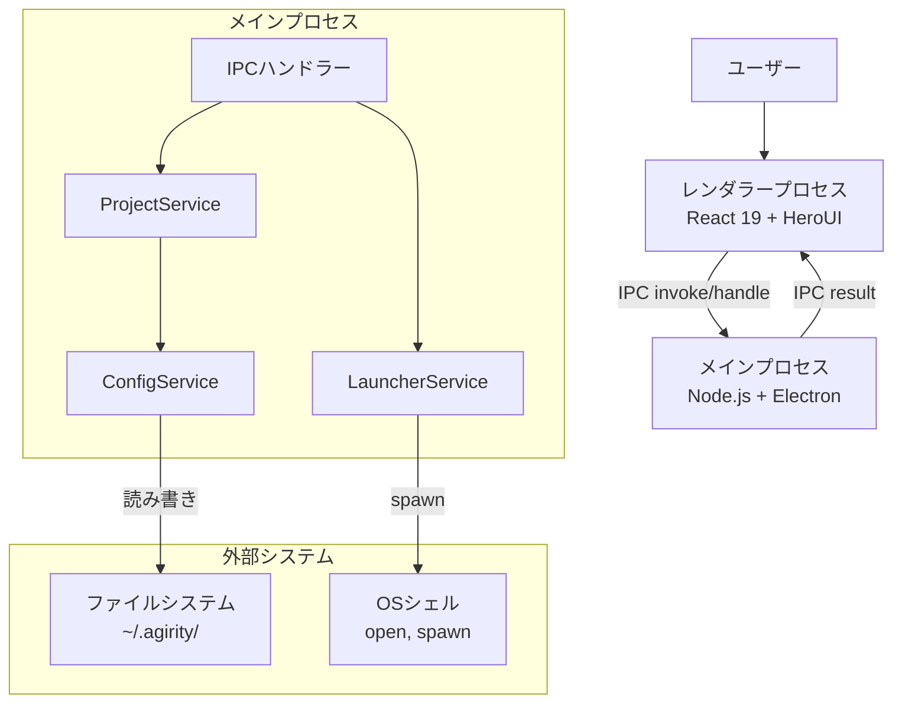
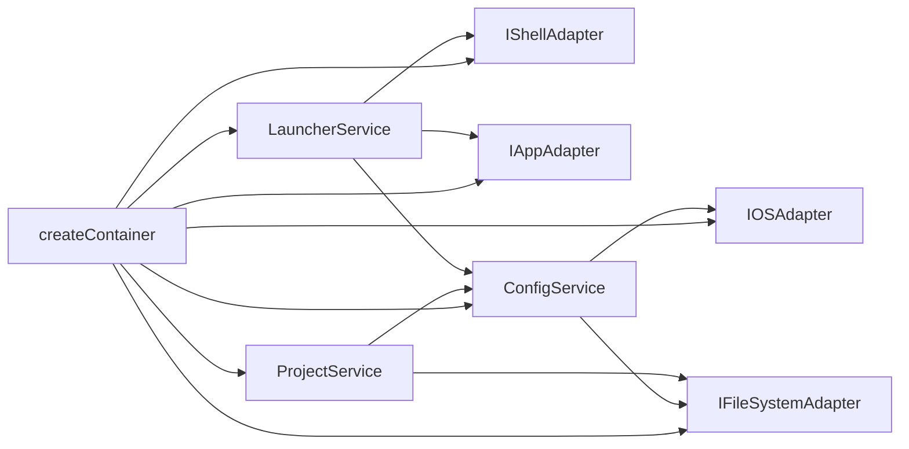
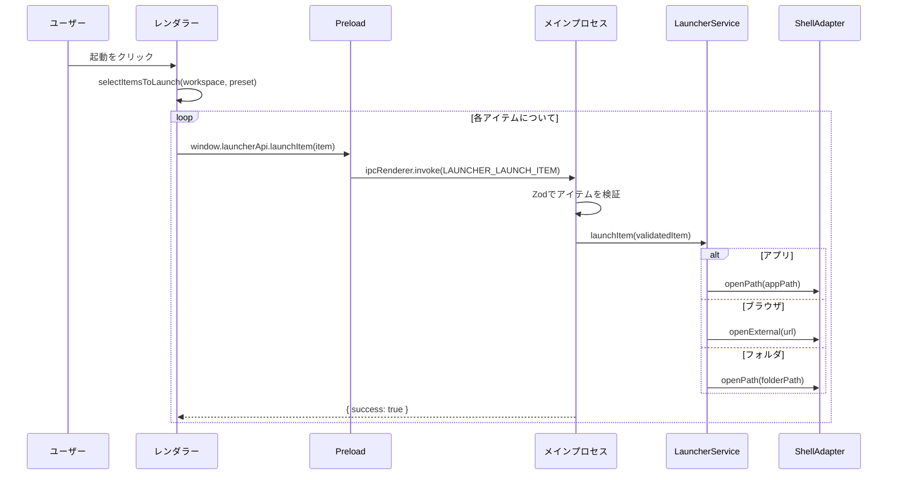

# アーキテクチャ

AgiRityは標準的なElectronマルチプロセスアーキテクチャを採用し、関心事の厳格な分離を行っています。メインプロセスがシステム操作とデータ永続化を担い、レンダラープロセスはReact SPAとしてIPC経由でのみ通信します。

## プロセスアーキテクチャ

## 依存性注入（DI）

メインプロセスは独自のDIコンテナ（`src/main/container.ts`）を使用します。アダプターがNode.js API（ファイルシステム、OS、シェル）をラップし、実際のシステムコールなしでサービスのテストが可能になっています。

オーバーライドは部分型の `AppContainer` として渡されます。テストではモックアダプターを注入し、本番では実アダプターを使用します。

## IPC設計

すべてのIPCはElectronの双方向 `invoke`/`handle` パターンを使用します。プリロードスクリプト（`src/main/preload.ts`）が `contextBridge` 経由で型付きAPIを公開します：

| API                   | メソッド            | 戻り値                               |
| --------------------- | ------------------- | ------------------------------------ |
| `window.launcherApi`  | `launchItem(item)`  | `LaunchResult`                       |
| `window.launcherApi`  | `getItemIcon(item)` | `IconResult`                         |
| `window.workspaceApi` | `load()`            | `WorkspaceResult<Workspace[]>`       |
| `window.workspaceApi` | `get(id)`           | `WorkspaceResult<Workspace \| null>` |
| `window.workspaceApi` | `save(workspace)`   | `WorkspaceResult<void>`              |
| `window.workspaceApi` | `delete(id)`        | `WorkspaceResult<boolean>`           |

入力は両側でZodにより検証されます。レンダラー側はUXフィードバックのため、メインプロセス側はセキュリティのためです。

## データフロー：ワークスペース起動

## データ保存

ワークスペースはYAML形式で `~/.agirity/workspaces.yaml` に保存され、`schemaVersion` フィールドを含みます。書き込み時には必ず `workspaces.yaml.bak` にバックアップが作成されます。`ConfigService` が設定ディレクトリパスを管理し、環境変数 `AGIRITY_CONFIG_DIR` による上書きに対応しています。

## UIアーキテクチャ

レンダラーはHeroUI v2.8+コンポーネントを使用し、ダークモードのみのテーマを適用しています。レイアウト構成：

- **AppShell** (`src/renderer/components/layout/AppShell.tsx`) — 最上位のflexコンテナ
- **AppHeader** (`src/renderer/components/layout/AppHeader.tsx`) — ロゴ、ワークスペーススイッチャー、起動ボタン、設定メニューを備えた44px固定ヘッダー
- **MainPanel** (`src/renderer/components/layout/MainPanel.tsx`) — ワークスペース名、プリセットチップ、アイテムカードグリッド

ビュールーティングは `src/renderer/App.tsx` で判別可能なユニオン型 `View` を使用しています：

| ビュー種別         | コンポーネント             |
| ------------------ | -------------------------- |
| `home`             | `WorkspaceList`            |
| `workspace`        | `MainPanel`                |
| `workspace-editor` | `WorkspaceEditor`          |
| `tools`            | `ToolsRegistry`（Phase 2） |
| `mcp`              | `MCPServers`（Phase 2）    |
| `settings`         | `Settings`                 |

## 主要ソースファイル

| ファイル                                      | 目的                                                                |
| --------------------------------------------- | ------------------------------------------------------------------- |
| `src/main/index.ts`                           | アプリライフサイクル、ウィンドウ生成、コンテナ・IPCセットアップ     |
| `src/main/container.ts`                       | アダプター→サービスのDIコンテナ配線                                 |
| `src/main/preload.ts`                         | レンダラーに型付きAPIを公開するコンテキストブリッジ                 |
| `src/main/ipc/index.ts`                       | Zod検証付きの全IPCハンドラー登録                                    |
| `src/shared/types.ts`                         | Zodスキーマ、TypeScript型、IPCチャンネル定数                        |
| `src/renderer/App.tsx`                        | ルートReactコンポーネント、ビュー状態管理、起動オーケストレーション |
| `src/renderer/components/layout/AppShell.tsx` | ヘッダー、コンテンツ領域を含むレイアウトシェル                      |
| `src/renderer/data/workspaceDataSource.ts`    | データアクセス層（モックまたはIPC）                                 |
