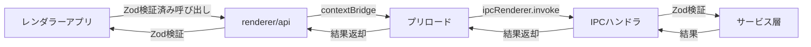

# IPCとプリロード

> アクティブコントリビューター: akkytech, Akihide Ito

## 目的

メインプロセスとレンダラープロセス間の安全な通信を管理します。Electronのコンテキスト分離を活用し、型安全なAPIブリッジを提供します。

## IPCチャネル一覧

| チャネル名 | 方向 | 入力 | 戻り値 | 用途 |
|-----------|------|------|--------|------|
| `launcher:launchItem` | R→M | `WorkspaceItem` | `LaunchResult` | アプリ/URL/フォルダを起動 |
| `launcher:getItemIcon` | R→M | `WorkspaceItem` | `IconResult` | アイコン/faviconを取得 |
| `workspace:load` | R→M | なし | `WorkspaceResult` | 全ワークスペースを読み込み |
| `workspace:get` | R→M | `string` (UUID) | `WorkspaceResult` | 特定ワークスペースを取得 |
| `workspace:save` | R→M | `Workspace` | `WorkspaceResult` | ワークスペースを保存 |
| `workspace:delete` | R→M | `string` (UUID) | `WorkspaceResult` | ワークスペースを削除 |

## プリロードブリッジ

`src/main/preload.ts`で`contextBridge.exposeInMainWorld`を使って2つのAPIを露出しています:

```typescript
window.launcherApi  // launchItem, getItemIcon
window.workspaceApi // load, get, save, delete
```

レンダラー側の`src/renderer/api/index.ts`は、これらのAPIを呼び出した後にZodスキーマでレスポンスを再検証します。

## Zodバリデーション（両側検証）

| 側 | 検証内容 | ファイル |
|----|---------|----------|
| メイン（ハンドラ） | 入力を`WorkspaceItemSchema`, `WorkspaceSchema`, `z.uuid()`で検証 | `src/main/ipc/index.ts` |
| レンダラー（API） | レスポンスを`LaunchResultSchema`, `IconResultSchema`, `WorkspaceResultSchema`で検証 | `src/renderer/api/index.ts` |

## セキュリティ設定

```typescript
// src/main/index.ts - createWindow()
webPreferences: {
  preload,
  nodeIntegration: false,      // Node.jsアクセス禁止
  contextIsolation: true,      // コンテキスト分離
}
```

- `nodeIntegration: false` — レンダラープロセスからNode.js APIへの直接アクセスを禁止
- `contextIsolation: true` — プリロードスクリプトとレンダラーのグローバルスコープを分離
- レンダラーは`window.launcherApi`と`window.workspaceApi`のみアクセス可能

## IPCデータフロー



## 主要ソースファイル

| ファイル | 役割 |
|----------|------|
| `src/shared/types.ts` | IPCチャネル定数、型、Zodスキーマ |
| `src/main/preload.ts` | コンテキストブリッジ、API露出 |
| `src/main/ipc/index.ts` | メイン側IPCハンドラ（Zod入力検証） |
| `src/renderer/api/index.ts` | レンダラー側APIラッパー（Zod出力検証） |
