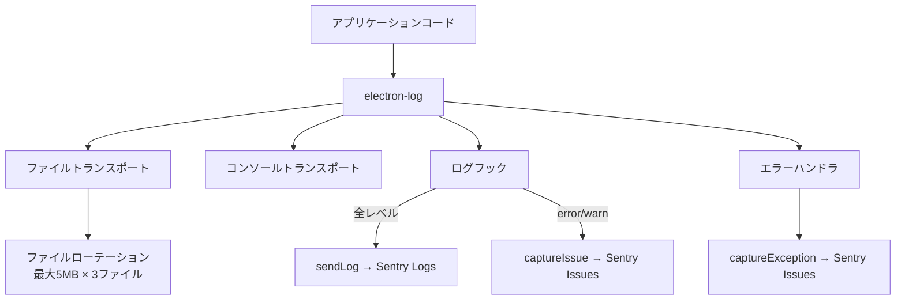

# ロギングとSentry

> アクティブコントリビューター: akkytech, Akihide Ito

## 目的

アプリケーション全体のログ管理とエラー監視を統合的に管理します。`electron-log`によるローカルログ出力と、`@sentry/electron`によるリモートエラー追跡を組み合わせています。

## electron-log設定

| 設定                       | 開発環境                                          | 本番環境  |
| -------------------------- | ------------------------------------------------- | --------- |
| ファイルログレベル         | `debug`                                           | `info`    |
| コンソールログレベル       | `debug`                                           | `warn`    |
| ファイルフォーマット       | `[{y}-{m}-{d} {h}:{i}:{s}.{ms}] [{level}] {text}` | 同左      |
| コンソールフォーマット     | `{h}:{i}:{s}.{ms} [{level}] {text}`               | 同左      |
| ファイル最大サイズ         | 5MB                                               | 5MB       |
| ローテーション数           | 3ファイル                                         | 3ファイル |
| レンダラーコンソールスパイ | 有効                                              | 無効      |

### ログファイル名

| プロセス   | ファイル名     |
| ---------- | -------------- |
| メイン     | `main.log`     |
| レンダラー | `renderer.log` |

## Sentry関数一覧

| 関数                   | 用途                             | 呼び出しタイミング                 |
| ---------------------- | -------------------------------- | ---------------------------------- |
| `initSentryMain()`     | メインプロセスのSentry初期化     | ロガー初期化時                     |
| `initSentryRenderer()` | レンダラープロセスのSentry初期化 | ロガー初期化時                     |
| `sendLog()`            | Sentry Logsへログ送信            | 全ログレベル                       |
| `captureIssue()`       | Sentry Issuesへメッセージ送信    | `error`, `warn`レベル              |
| `captureException()`   | Sentry Issuesへ例外送信          | エラーハンドラ                     |
| `flushSentry()`        | 終了前にバッファをフラッシュ     | `before-quit`, `window-all-closed` |

### Sentry初期化パラメータ

| パラメータ           | メイン                            | レンダラー                         |
| -------------------- | --------------------------------- | ---------------------------------- |
| DSN取得元            | `process.env.SENTRY_DSN`          | `import.meta.env.VITE_SENTRY_DSN`  |
| リリース             | `process.env.npm_package_version` | `import.meta.env.VITE_APP_VERSION` |
| トレースサンプリング | 開発:1.0 / 本番:0.1               | 未設定                             |
| ログ有効化           | `true`                            | `true`                             |

## 環境変数

| 変数                  | プロセス   | 用途               | 必須                         |
| --------------------- | ---------- | ------------------ | ---------------------------- |
| `SENTRY_DSN`          | メイン     | Sentry DSN         | 任意（未設定時はSentry無効） |
| `VITE_SENTRY_DSN`     | レンダラー | Sentry DSN         | 任意                         |
| `VITE_APP_VERSION`    | レンダラー | リリースバージョン | 任意                         |
| `NODE_ENV`            | 両方       | 開発/本番判定      | 自動設定                     |
| `VITE_DEV_SERVER_URL` | 両方       | 開発サーバーURL    | Vite自動設定                 |

## ログフロー

## DSN未設定時の動作

Sentry DSNが未設定の場合、全てのSentry関数は早期リターンし、オーバーヘッドなしで動作します。これは開発環境やCIでの実行時に便利です。

## 主要ソースファイル

| ファイル                           | 役割                                                   |
| ---------------------------------- | ------------------------------------------------------ |
| `src/shared/lib/logging/config.ts` | ログ設定定数（開発判定、フォーマット、ローテーション） |
| `src/main/lib/logger.ts`           | メインプロセスロガー初期化、Sentry連携                 |
| `src/main/lib/sentry.ts`           | メインプロセスSentry統合                               |
| `src/renderer/lib/logger.ts`       | レンダラープロセスロガー初期化                         |
| `src/renderer/lib/sentry.ts`       | レンダラープロセスSentry統合                           |
