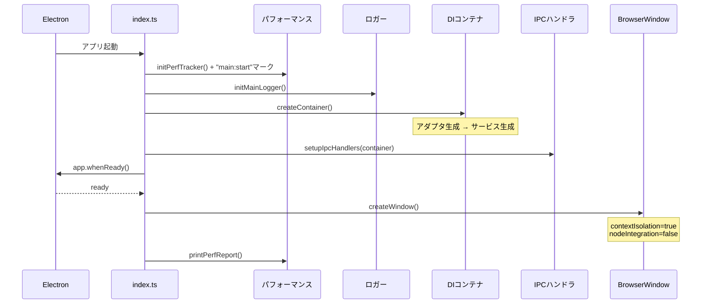

# メインプロセス

> アクティブコントリビューター: akkytech, Akihide Ito

## 目的

メインプロセスはAgiRityのバックエンド層として、Electronのライフサイクル管理、ファイルシステム操作、アプリケーション起動、ワークスペースの永続化を担います。DIコンテナによる依存性注入でテスト容易性を確保し、アダプタパターンで外部依存を抽象化しています。

## ディレクトリ構成

```
src/main/
├── index.ts              # エントリポイント、Electronライフサイクル
├── container.ts          # DIコンテナ定義
├── preload.ts            # プリロードスクリプト
├── ipc/
│   └── index.ts          # IPCハンドラ登録
├── adapters/
│   ├── interfaces.ts     # アダプタインターフェース
│   ├── AppAdapter.ts     # アイコン取得、favicon取得
│   ├── FileSystemAdapter.ts  # ファイルシステム操作
│   ├── OSAdapter.ts      # OS情報
│   └── ShellAdapter.ts   # アプリ起動、パスオープン
├── services/
│   ├── interfaces.ts     # サービスインターフェース
│   ├── ConfigService.ts  # 設定ディレクトリ管理
│   ├── ProjectService.ts # ワークスペースCRUD
│   └── LauncherService.ts # アプリ/URL/フォルダ起動
└── lib/
    ├── logger.ts         # electron-log初期化
    ├── sentry.ts         # Sentry統合
    └── perf.ts           # パフォーマンストラッキング
```

## 主要抽象化

| 型 | 役割 |
|----|------|
| `IFileSystemAdapter` | Node.js fs.promisesのラッパー |
| `IOSAdapter` | `os.homedir()`の抽象化 |
| `IShellAdapter` | Electron Shell APIの抽象化 |
| `IAppAdapter` | アプリアイコン・favicon取得の抽象化 |
| `IConfigService` | 設定ディレクトリ・パス管理 |
| `IProjectService` | ワークスペースのCRUD操作 |
| `ILauncherService` | アプリ/URL/フォルダの起動 |
| `AppContainer` | 全アダプタとサービスを統合するDIコンテナ |

## 動作

### 起動シーケンス



### アダプタパターン

全ての外部依存はインターフェース（`IFileSystemAdapter`, `IOSAdapter`など）で抽象化されています。`createContainer()`は具象実装を生成し、オプションの`overrides`引数でテスト時にモックを注入できます。

### サービス群

- **ConfigService**: `~/.config/agirity/`（macOS）などの設定ディレクトリを管理
- **ProjectService**: YAMLファイルからワークスペースを読み込み・保存・削除
- **LauncherService**: `WorkspaceItem`の`type`に応じて`ShellAdapter`経由でアプリ/URL/フォルダを起動

## 統合ポイント

- **IPC**: `setupIpcHandlers()`で6チャネルを登録。Zodによる入力バリデーション
- **ロギング**: `electron-log`でファイル・コンソールに出力。Sentryにエラー送信
- **パフォーマンス**: 起動シーケンス全体を計測し、レポートをログ出力

## 変更の入口

- 新しいIPCチャネル追加 → `src/shared/types.ts`にチャネル定義 → `src/main/ipc/index.ts`にハンドラ追加
- 新しいサービス追加 → `src/main/services/`にインターフェースと実装 → `src/main/container.ts`に登録
- 新しいアダプタ追加 → `src/main/adapters/`にインターフェースと実装 → `src/main/container.ts`に登録

## 主要ソースファイル

| ファイル | 役割 |
|----------|------|
| `src/main/index.ts` | Electronライフサイクル、ウィンドウ管理 |
| `src/main/container.ts` | DIコンテナ定義、依存関係の組み立て |
| `src/main/adapters/AppAdapter.ts` | アプリアイコン取得、favicon取得（SSRF保護付き） |
| `src/main/adapters/FileSystemAdapter.ts` | ファイル読み書き |
| `src/main/adapters/ShellAdapter.ts` | アプリ起動、URL/パスオープン |
| `src/main/services/ProjectService.ts` | ワークスペースCRUD |
| `src/main/services/LauncherService.ts` | アイテム起動ロジック |
| `src/main/services/ConfigService.ts` | 設定パス管理 |
| `src/main/ipc/index.ts` | IPCハンドラ（6チャネル） |
| `src/main/preload.ts` | コンテキストブリッジ定義 |
