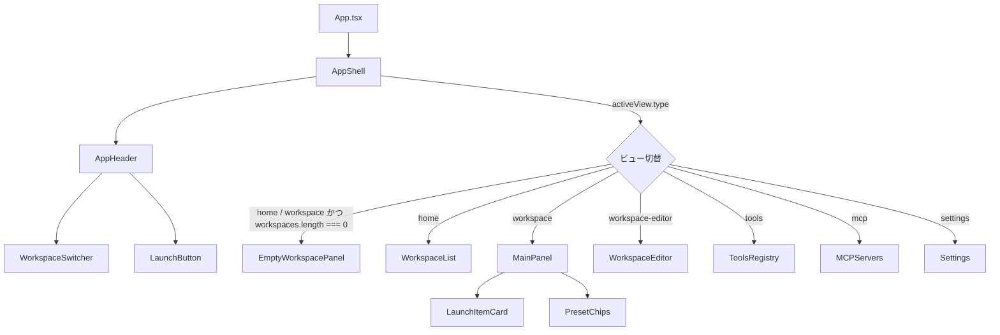

# レンダラーアプリシェル

> アクティブコントリビューター: akkytech, Akihide Ito

## 目的

Reactアプリケーション全体のルーティング、状態管理、データ層を管理します。ユーザーインターフェースの骨格を構成し、ビューの切替えとワークスペース操作を統合しています。

## ディレクトリ構成

```
src/renderer/
├── index.tsx              # エントリポイント、StrictMode
├── App.tsx                # ルートコンポーネント、View状態管理
├── index.css              # グローバルスタイル
├── api/
│   └── index.ts           # IPC APIラッパー（Zod検証付き）
├── components/
│   ├── layout/
│   │   ├── AppShell.tsx       # アプリ全体のレイアウト枠
│   │   ├── AppHeader.tsx      # ヘッダーバー
│   │   ├── MainPanel.tsx      # ワークスペース詳細パネル
│   │   └── EmptyWorkspacePanel.tsx  # ワークスペースなし時
│   ├── workspace/
│   │   ├── LaunchButton.tsx   # 起動ボタン
│   │   ├── LaunchItemCard.tsx # 起動アイテムカード
│   │   ├── PresetChips.tsx    # プリセット選択チップ
│   │   └── WorkspaceSwitcher.tsx  # ワークスペース切替
│   ├── WorkspaceList.tsx      # ワークスペース一覧
│   ├── WorkspaceDetail.tsx    # ワークスペース詳細
│   ├── WorkspaceEditor.tsx    # ワークスペース編集
│   ├── ItemEditor.tsx         # アイテムエディタ
│   ├── AddItemModal.tsx       # アイテム追加モーダル
│   ├── PresetCard.tsx         # プリセットカード
│   ├── ToolCard.tsx           # ツールカード
│   ├── ToolsRegistry.tsx      # ツールレジストリ
│   ├── MCPServers.tsx         # MCPサーバー一覧
│   └── Settings.tsx           # 設定画面
├── data/
│   └── workspaceDataSource.ts  # データ層（モック/リアル切替）
├── mocks/
│   └── workspaces.ts         # モックデータ
├── hooks/                    # カスタムフック
├── lib/
│   ├── logger.ts             # レンダラーロガー
│   ├── perf.ts               # レンダラーパフォーマンス計測
│   └── sentry.ts             # レンダラーSentry統合
└── utils.ts                  # ユーティリティ
```

## 主要抽象化

### View型（ビュールーティング）

```typescript
type View =
  | { type: 'home' }
  | { type: 'workspace'; id: string }
  | { type: 'workspace-editor'; id?: string }
  | { type: 'tools' }
  | { type: 'mcp' }
  | { type: 'settings' };
```

### workspaceDataSource（データ層）

`VITE_USE_MOCK_DATA`環境変数でモックデータとリアルIPCを切り替えます:

| モード | 環境変数              | 動作                                |
| ------ | --------------------- | ----------------------------------- |
| リアル | `false`（デフォルト） | `workspaceApi`経由でIPC通信         |
| モック | `true`                | `MOCK_WORKSPACES`をインメモリで操作 |

## ビュールーティング



ワークスペースが0件の場合の `EmptyWorkspacePanel` は `home` / `workspace` ビューでのみ表示されます。`workspace-editor`・`settings`・`tools`・`mcp` ビューには0件でも遷移できます。`MainPanel` の編集ボタン（`onEditWorkspace`）から既存ワークスペースの `workspace-editor` ビューへ遷移します。

## 起動フロー

1. ユーザーがヘッダー（`AppHeader`）の `LaunchButton` をクリック
2. `App.tsx`の`handleLaunch`が、`getPresetItemNames()`で解決した選択中プリセットのアイテム名とともに呼ばれる
3. `selectItemsToLaunch()`でプリセットに基づきアイテムをフィルタリング（未選択は全件、空プリセットは0件）
4. 各アイテムに対して`launcherApi.launchItem()`をIPC呼び出し
5. レスポンスをZodで検証

## データフロー

```
ユーザー操作 → App.tsx (useState) → workspaceDataSource → workspaceApi (IPC) → メインプロセス
```

## 主要ソースファイル

| ファイル                                       | 役割                                             |
| ---------------------------------------------- | ------------------------------------------------ |
| `src/renderer/index.tsx`                       | エントリポイント、ログ初期化                     |
| `src/renderer/App.tsx`                         | ルートコンポーネント、View状態管理、起動ロジック |
| `src/renderer/api/index.ts`                    | IPC APIラッパー（Zod検証）                       |
| `src/renderer/data/workspaceDataSource.ts`     | データ層（モック/リアル切替）                    |
| `src/renderer/components/layout/AppShell.tsx`  | アプリ全体レイアウト                             |
| `src/renderer/components/layout/MainPanel.tsx` | ワークスペース詳細パネル                         |
| `src/renderer/components/WorkspaceEditor.tsx`  | ワークスペース編集フォーム                       |
| `src/renderer/components/WorkspaceList.tsx`    | ワークスペース一覧表示                           |
